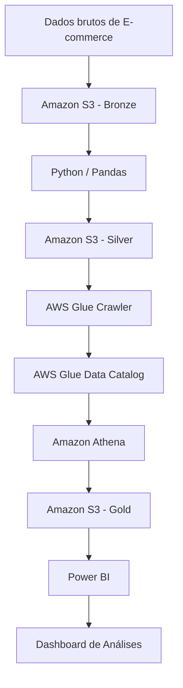

# 🛒 Data Lake de E-commerce na AWS

## 📌 Sobre o projeto

Este projeto tem como objetivo desenvolver um Data Lake na AWS para armazenar, organizar, transformar e consultar dados de pedidos de um cenário de comércio eletrônico.

A solução foi desenvolvida utilizando uma arquitetura em camadas, permitindo organizar os dados desde sua forma original até uma estrutura preparada para análises e visualizações.

O projeto foi desenvolvido como parte dos meus estudos práticos em Engenharia de Dados e Computação em Nuvem.

## 🎯 Objetivos

- Construir um Data Lake utilizando Amazon S3.
- Organizar os dados nas camadas Bronze, Silver e Gold.
- Realizar o tratamento e a transformação dos dados.
- Utilizar AWS Glue para catalogação dos dados.
- Consultar informações utilizando Amazon Athena.
- Criar um dashboard para visualização dos resultados no Power BI.

## 🏗️ Arquitetura do projeto

O projeto utiliza uma arquitetura dividida em três camadas:

- **Bronze:** armazenamento dos dados brutos, preservando sua estrutura original.
- **Silver:** dados tratados, padronizados e preparados para análise.
- **Gold:** dados consolidados e organizados para consultas e visualizações.

### Fluxo de dados

1. Os dados de pedidos são armazenados no Amazon S3.
2. Os dados passam por processos de limpeza e transformação.
3. Os arquivos tratados são armazenados em formato Parquet na camada Silver.
4. O AWS Glue realiza a catalogação dos dados.
5. O Amazon Athena permite executar consultas SQL.
6. Os resultados são utilizados na construção de um dashboard no Power BI.

## 🛠️ Tecnologias utilizadas

- **Amazon S3:** armazenamento dos dados.
- **AWS Glue:** catalogação e organização dos metadados.
- **Amazon Athena:** consultas SQL.
- **Python:** tratamento e transformação dos dados.
- **Pandas:** manipulação dos dados.
- **Parquet:** formato de armazenamento dos dados tratados.
- **Power BI:** visualização e análise dos resultados.

## 🧹 Tratamento dos dados

Durante o processamento, foram identificadas e tratadas inconsistências, como:

- Diferentes formatos de datas.
- Valores ausentes em campos como CPF, e-mail, desconto e frete.
- Quantidades inválidas.
- Valores de desconto em formatos inconsistentes.
- E-mails malformados.
- CPFs inválidos.

Também foram realizadas padronizações e verificações para melhorar a qualidade dos dados.

## 📊 Resultados

O projeto permitiu organizar os dados de pedidos em um fluxo estruturado de armazenamento, processamento e consulta.

Foi desenvolvido um dashboard no Power BI com análises como:

- Faturamento por categoria.
- Faturamento por região.

## 🏗️ Arquitetura do Data Lake

O projeto utiliza uma arquitetura em três camadas no Amazon S3, organizando os dados desde a entrada até a disponibilização para análise.

### Camadas do Data Lake

- **Bronze:** armazenamento dos dados originais.
- **Silver:** dados tratados e padronizados.
- **Gold:** resultados preparados para análises e visualizações.

## 📚 Aprendizados

Com este projeto, pude praticar conceitos importantes de Engenharia de Dados, incluindo armazenamento em nuvem, organização de Data Lakes, transformação de dados, catalogação, consultas SQL e visualização de informações.

---

**Projeto desenvolvido para fins de aprendizado e construção de portfólio em Engenharia de Dados.**
